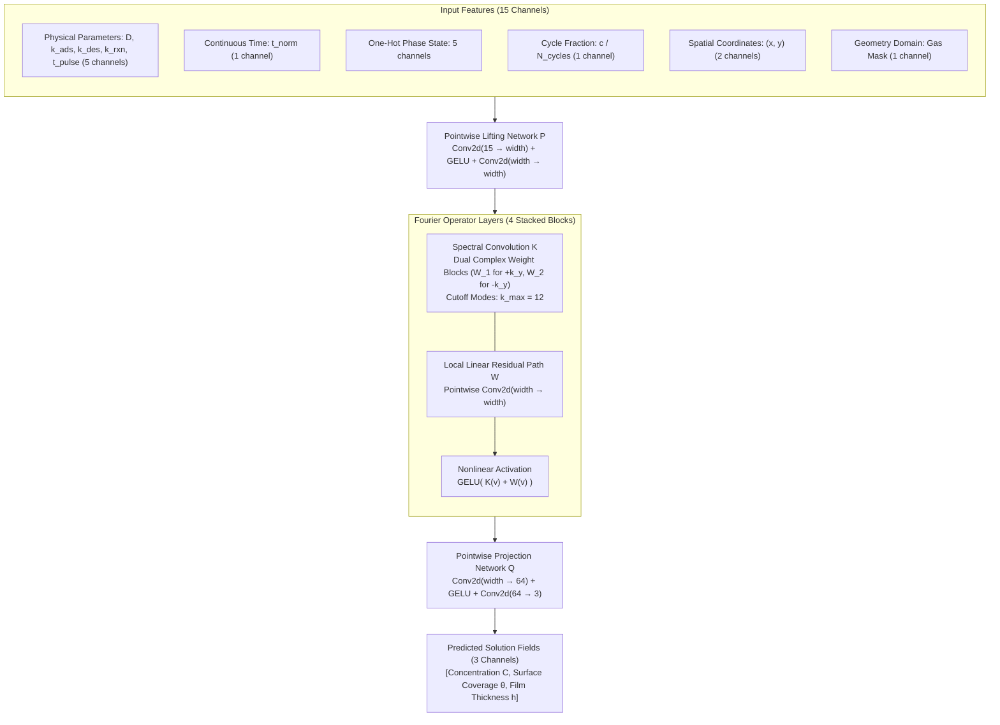

# Physics-Informed Neural Operator for Transient Atomic Layer Deposition

[](https://www.python.org/)
[](LICENSE)
[](https://pytorch.org/)
[](#)
[](#)
[](https://github.com/neil6714/thin-film-pino/actions/workflows/ci.yml)

A continuum simulator and scientific machine learning surrogate for transient atomic layer deposition (ALD) in microelectronic trench features. The numerical engine models multi-species vapor transport, Langmuir surface kinetics, and thin-film growth using an operator-split forward-time central-space (FTCS) finite-difference scheme. The neural surrogate framework employs a Temporal Fourier Neural Operator (FNO) regularized with continuous autograd-derived partial differential equation (PDE) collocation residuals (PINO).

---

## 1. Materials Science and Mathematical Theory

### 1.1 Atomic Layer Deposition in High-Aspect-Ratio Features
Atomic layer deposition is a vapor-phase thin-film fabrication technique characterized by sequential, self-limiting chemical half-reactions. In modern semiconductor manufacturing (including 3D NAND memory holes, FinFETs, and gate-all-around nanosheets), conformal deposition across high-aspect-ratio (HAR) topographies is constrained by the interplay between Knudsen vapor diffusion and irreversible surface chemisorption.

```
       Vapor Inlet: C(x, 0, t) = C_0 (Dose) or 0 (Purge)
       ══════════════════════════════════════════════════
       │                                                │
       │                 Top Field Region               │
       │              (y <= y_top, Planar)              │
       │                                                │
       │         ┌────────────────────────────┐         │
       │         │                            │         │
       │         │      Trench Sidewall       │         │
       │         │      (x_left, x_right)     │         │
       │ Solid   │                            │  Solid  │
       │ Feature │                            │ Feature │
       │         │        Aspect Ratio:       │         │
       │         │         AR = d / w         │         │
       │         │                            │         │
       │         │                            │         │
       │         │        Trench Floor        │         │
       │         └────────────────────────────┘         │
       │              (y >= y_bottom)                   │
       ══════════════════════════════════════════════════
```

In features with characteristic dimensions $w \lesssim 100\text{ nm}$, the mean free path of gas molecules $\lambda$ is comparable to or larger than the pore width. The Knudsen number:

$$
Kn = \frac{\lambda}{w}
$$

governs transport. While ballistic regimes require direct simulation Monte Carlo (DSMC) or transmission probability integrals, mesoscopic feature-scale continuum models describe the process using an effective Fickian diffusivity $D_{\mathrm{eff}}$, capturing the combined effects of molecular collisions and wall collisions.

### 1.2 Surface Reaction Kinetics
Precursor adsorption follows a site-saturating Langmuir chemisorption isotherm. Let $\theta(x, y, t) \in [0, 1]$ represent the local fractional surface coverage of chemisorbed precursor molecules relative to the maximum active site density $\theta_{\max}$.

1. **Chemisorption Flux ($R_{\mathrm{ads}}$)**: Proportional to gas-phase precursor concentration $C$ and available open surface sites $(1 - \theta)$:

$$
R_{\mathrm{ads}} = k_{\mathrm{ads}} C (1 - \theta)
$$

2. **Thermal Desorption Flux ($R_{\mathrm{des}}$)**: First-order unreactive loss of chemisorbed precursor:

$$
R_{\mathrm{des}} = k_{\mathrm{des}} \theta
$$

3. **Coreactant Conversion Flux ($R_{\mathrm{rxn}}$)**: Conversion of chemisorbed precursor into solid film during exposure to a secondary oxidizing or reducing agent:

$$
R_{\mathrm{rxn}} = k_{\mathrm{rxn}} \theta
$$

Film thickness $h(x, y, t)$ increases monotonically as converted precursor integrates into the solid lattice:

$$
\frac{\partial h}{\partial t} = k_{\mathrm{growth}} R_{\mathrm{rxn}}
$$

where $k_{\mathrm{growth}}$ is the net volumetric growth constant per unit reacted coverage.

### 1.3 Operator-Split Cyclic ALD Formulation
A standard binary ALD cycle consists of four distinct operational stages executed sequentially:

#### Phase 1: Precursor Dose ($\tau_{\mathrm{dose}}$)
Precursor vapor is introduced from the top boundary ($C(x, 0, t) = C_0$). Diffusion, chemisorption, and thermal desorption occur concurrently:

$$
\frac{\partial C}{\partial t} = D_{\mathrm{eff}} \nabla^2 C - R_{\mathrm{ads}} \quad \text{in } \Omega_{\mathrm{gas}}
$$

$$
\frac{\partial \theta}{\partial t} = R_{\mathrm{ads}} - R_{\mathrm{des}} \quad \text{on } \Gamma_{\mathrm{surf}}
$$

$$
\frac{\partial h}{\partial t} = 0 \quad \text{on } \Gamma_{\mathrm{surf}}
$$

#### Phase 2: Post-Dose Inert Purge ($\tau_{\mathrm{purge}, 1}$)
Precursor supply is stopped ($C(x, 0, t) = 0$). Unreacted gas diffuses out of the trench:

$$
\frac{\partial C}{\partial t} = D_{\mathrm{eff}} \nabla^2 C \quad \text{in } \Omega_{\mathrm{gas}}
$$

$$
\frac{\partial \theta}{\partial t} = 0, \quad \frac{\partial h}{\partial t} = 0 \quad \text{on } \Gamma_{\mathrm{surf}}
$$

At the completion of Phase 2, unreacted gas is evacuated from the feature domain ($C \equiv 0$).

#### Phase 3: Coreactant Dose and Film Growth ($\tau_{\mathrm{rxn}}$)
Coreactant vapor is supplied in excess. Precursor gas is absent ($C \equiv 0$). Surface chemisorbed species convert into solid film:

$$
C(x, y, t) \equiv 0 \quad \text{in } \Omega_{\mathrm{gas}}
$$

$$
\frac{\partial \theta}{\partial t} = - R_{\mathrm{rxn}} \quad \text{on } \Gamma_{\mathrm{surf}}
$$

$$
\frac{\partial h}{\partial t} = k_{\mathrm{growth}} R_{\mathrm{rxn}} \quad \text{on } \Gamma_{\mathrm{surf}}
$$

#### Phase 4: Post-Reaction Inert Purge ($\tau_{\mathrm{purge}, 2}$)
Reaction byproducts are purged:

$$
\frac{\partial C}{\partial t} = 0, \quad \frac{\partial \theta}{\partial t} = 0, \quad \frac{\partial h}{\partial t} = 0
$$

Residual unconverted coverage $\theta$ carries over into subsequent cycles.

### 1.4 Boundary Conditions and Metric Definitions
- **Top Inlet ($y = 0$)**: Dirichlet boundary condition $C(x, 0, t) = 1.0$ during precursor dose; $C(x, 0, t) = 0.0$ during purge.
- **Solid Domain Walls ($\Gamma_{\mathrm{wall}}$)**: Homogeneous Neumann condition (zero-flux reflection):

$$
\nabla C \cdot \mathbf{n} = 0
$$

- **Step Coverage ($\mathrm{SC}$)**: Ratio of average film thickness deposited on the trench bottom floor to average thickness deposited on the planar top field:

$$
\mathrm{SC} = \frac{\bar{h}_{\mathrm{floor}}}{\bar{h}_{\mathrm{field}}}
$$

- **Growth Per Cycle ($\mathrm{GPC}$)**: Mean thickness increment per complete four-phase cycle:

$$
\mathrm{GPC} = \frac{\Delta h_{\mathrm{cycle}}}{N_{\mathrm{cycles}}}
$$

---

## 2. Machine Learning Theory and Neural Operator Architecture

### 2.1 The Need for Operator Learning
Conventional explicit finite-difference methods (FTCS) are constrained by numerical diffusion and the Courant-Friedrichs-Lewy (CFL) stability criterion:

$$
\Delta t \le \min\left( \frac{\min(\Delta x, \Delta y)^2}{4 D_{\max}}, \frac{1}{\max(k_{\mathrm{ads}}, k_{\mathrm{rxn}})} \right)
$$

Refining the spatial resolution by a factor of 2 shrinks the allowable time step by a factor of 4, yielding an $\mathcal{O}(N^4)$ computational complexity scaling across space and time. Exploring multi-cycle parameter spaces (diffusivity, reaction rates, pulse times) with traditional numerical solvers is computationally prohibitive.

Neural operators learn mappings between infinite-dimensional function spaces. Instead of mapping a fixed-grid input to a fixed-grid output, a neural operator parameterizes a continuous mapping:

$$
\mathcal{G}_\theta : \mathcal{A} \to \mathcal{U}
$$

from the parameter and coordinate space $\mathcal{A}$ to the spatiotemporal solution field manifold $\mathcal{U}$.



The mathematical transformation across layer $l$ is defined as:

$$
v_{l+1}(x, y) = \mathrm{GELU}\left( W v_l(x, y) + (\mathcal{K}_\phi v_l)(x, y) \right)
$$

where $W$ is a local pointwise linear operator and $\mathcal{K}_\phi$ is a non-local kernel integral parameterized in frequency space via the 2D Fast Fourier Transform:

$$
(\mathcal{K}_\phi v_l)(x, y) = \mathcal{F}^{-1} \left[ R_\phi(k_x, k_y) \cdot (\mathcal{F} v_l)(k_x, k_y) \right](x, y)
$$

### 2.2 Dual-Weight Spectral Convolution for Non-Periodic Boundaries
Because real physical ALD domains have non-periodic vertical boundary conditions (Dirichlet precursor vapor inlet at $y = 0$, solid substrate trench bottom at $y = 1$), standard periodic Fourier convolutions introduce boundary Gibbs artifacts. To address this, the implementation utilizes a dual-weight spectral convolution block:
- Weight block $W_1$ acts on positive vertical wavenumber modes ($k_y \ge 0$).
- Weight block $W_2$ acts on negative vertical wavenumber modes ($k_y < 0$).

Truncating higher frequencies at modal cutoff $k_{\max} = 12$ acts as an implicit inductive regularizer, filtering high-frequency numerical oscillations while preserving sharp step interfaces along feature walls.

### 2.3 Physics-Informed Neural Operator (PINO)
While pure FNO minimizes empirical risk on discrete labeled snapshots, Physics-Informed Neural Operators integrate the continuous governing equations directly into the loss function:

$$
\mathcal{L}_{\mathrm{PINO}} = \mathcal{L}_{\mathrm{data}} + \lambda_{\mathrm{physics}} \mathcal{L}_{\mathrm{PDE}}
$$

#### Channel-Masked Supervised Loss ($\mathcal{L}_{\mathrm{data}}$)
Because the surface interface $\Gamma_{\mathrm{surf}}$ occupies only a fraction of domain cells compared to the interior gas domain $\Omega_{\mathrm{gas}}$, an unweighted loss would cause the network to ignore surface coverage and film thickness. The data loss computes masked errors normalized independently per channel:

$$
\mathcal{L}_{\mathrm{data}} = \frac{1}{\sum_{c=1}^3 w_c} \sum_{c=1}^3 w_c \left( \frac{1}{|\Omega_c|} \sum_{(x, y) \in \Omega_c} \left| u_c(x, y, t) - \hat{u}_c(x, y, t) \right|^2 \right)
$$

where $\Omega_1 = \Omega_{\mathrm{gas}}$ for concentration $C$, and $\Omega_2 = \Omega_3 = \Gamma_{\mathrm{surf}}$ for surface coverage $\theta$ and thickness $h$.

#### Continuous Spatiotemporal Collocation ($\mathcal{L}_{\mathrm{PDE}}$)
Unlike standard PINNs that evaluate residuals at fixed discrete points, PINO computes exact continuous time derivatives on arbitrary intermediate collocation points sampled inside exposure windows using reverse-mode automatic differentiation:

$$
\frac{\partial \hat{u}_c}{\partial t} = \frac{1}{\sigma_t} \cdot \frac{\partial \hat{u}_c}{\partial t_{\mathrm{norm}}} \quad \text{via} \quad \texttt{torch.autograd.grad}
$$

Spatial diffusion is computed on the predicted fields using a 5-point discrete Laplacian stencil with mirrored zero-flux Neumann boundary conditions:

$$
\mathcal{L}_{\mathrm{transport}} = \frac{1}{|\Omega_{\mathrm{gas}}|} \sum_{\Omega_{\mathrm{gas}}} \left| \frac{\partial \hat{C}}{\partial t} - D \nabla^2 \hat{C} + \hat{R}_{\mathrm{ads}} \right|^2
$$

$$
\mathcal{L}_{\mathrm{coverage}} = \frac{1}{|\Gamma_{\mathrm{surf}}|} \sum_{\Gamma_{\mathrm{surf}}} \left| \frac{\partial \hat{\theta}}{\partial t} - (\hat{R}_{\mathrm{ads}} - \hat{R}_{\mathrm{des}}) \right|^2
$$

$$
\mathcal{L}_{\mathrm{growth}} = \frac{1}{|\Gamma_{\mathrm{surf}}|} \sum_{\Gamma_{\mathrm{surf}}} \left| \frac{\partial \hat{h}}{\partial t} - k_{\mathrm{growth}} \hat{R}_{\mathrm{rxn}} \right|^2
$$

Total PDE loss scales each residual by the empirical standard deviation of the corresponding field, preventing magnitude differences from biasing optimization:

$$
\mathcal{L}_{\mathrm{PDE}} = \frac{1}{3} \left( \frac{\mathcal{L}_{\mathrm{transport}}}{\sigma_C^2} + \frac{\mathcal{L}_{\mathrm{coverage}}}{\sigma_\theta^2} + \frac{\mathcal{L}_{\mathrm{growth}}}{\sigma_h^2} \right)
$$

---

## 3. Data Schema and Stratification

### 3.1 Input Parameters and Prior Distributions
Parameters are sampled independently using pseudo-random Sobol/Halton sequences configured in [configs/priors.yaml](configs/priors.yaml):

| Parameter | Symbol | Distribution | Range / Value | Physical Meaning |
| :--- | :---: | :---: | :--- | :--- |
| Gas Diffusivity | $D$ | Uniform | $[1.0 \times 10^{-3}, 8.0 \times 10^{-3}]$ | Effective binary vapor diffusivity |
| Chemisorption Rate | $k_{\mathrm{ads}}$ | Uniform | $[0.5, 1.5]$ | Precursor sticking and adsorption rate |
| Desorption Rate | $k_{\mathrm{des}}$ | Uniform | $[0.02, 0.10]$ | Thermal desorption rate |
| Coreactant Rate | $k_{\mathrm{rxn}}$ | Uniform | $[0.1, 0.8]$ | Surface reaction kinetic rate |
| Growth Coefficient | $k_{\mathrm{growth}}$ | Constant | $0.02$ | Converted film thickness per unit coverage |
| Precursor Exposure | $t_{\mathrm{pulse}}$ | Bimodal Mixture | $85\%\; [10.0, 50.0]\text{ s},\; 15\%\; [50.0, 60.0]\text{ s}$ | Dose exposure duration |
| Purge Times | $t_{\mathrm{purge}}$ | Constant | $1.0\text{ s}$ | Inert carrier gas purge duration |
| Reaction Time | $t_{\mathrm{rxn}}$ | Constant | $1.0\text{ s}$ | Secondary coreactant exposure duration |

### 3.2 Dataset Stratification and Leakage Prevention
To ensure rigorous evaluation, trajectories are partitioned before model training:
1. **Train Subset (70%)**: Parameter space for empirical loss minimization.
2. **Validation Subset (15%)**: Model selection and learning rate scheduling.
3. **In-Distribution Test Subset (15%)**: Held-out trajectories sampled from the standard exposure distribution.
4. **Out-of-Distribution (OOD) Holdout**: Trajectories with extended dose times ($t_{\mathrm{pulse}} \in [50.0, 60.0]\text{ s}$) reserved strictly for assessing physical extrapolation.

All normalization statistics (mean $\mu$ and standard deviation $\sigma$) are computed strictly on the training partition:

$$
x_{\mathrm{norm}} = \frac{x - \mu_{\mathrm{train}}}{\sigma_{\mathrm{train}} + \epsilon}
$$

Validation and test samples are normalized using the training moments, preventing data leakage across split boundaries.

---

## 4. Empirical Benchmarks: Few-Shot and Out-of-Distribution Regimes

### 4.1 When Does PINO Outperform Pure FNO?
In high-data regimes where thousands of labeled snapshots are available, pure data-driven operators (FNO) interpolate empirical trajectories effectively. The physical regularization term of PINO becomes decisive under two real-world scientific computing conditions:

1. **Few-Shot Learning (Data Scarcity)**: Full finite-difference simulations of deep 3D trenches are computationally expensive. When training data is limited to a small sample size ($N_{\mathrm{train}} = 16$ trajectories), pure FNO lacks sufficient points to map the 7-dimensional parameter space. PINO leverages continuous PDE residuals on unobserved spatiotemporal coordinates to restrict the solution manifold to physically valid states.
2. **Out-of-Distribution (OOD) Generalization**: Machine learning surrogates deployed in optimization loops frequently encounter conditions outside their training distribution (such as extended dose exposures or deep trenches). Pure FNO exhibits catastrophic extrapolation drift, producing negative concentrations and non-monotonic thickness. PINO penalizes violations of mass conservation and reaction rates everywhere, preserving physical consistency.

### 4.2 Benchmark Results (Nvidia Tesla T4 GPU)

#### Full Benchmark (161 Training Trajectories, 25 Epochs)
- **Train-Mean Baseline**: Normalized MSE = $1.000000$, MAE = $0.841029$.
- **FNO Baseline**: Test Loss = $0.1181$, Normalized MAE = $0.2028$.
- **PINO** ($\lambda = 10^{-4}$): Test Loss = $0.1181$, Normalized MAE = $0.2028$.

#### Few-Shot Benchmark (16 Training Trajectories, 30 Epochs, $\lambda = 0.02$)
When training data was reduced to $10\%$ of the dataset, both models were tested on the held-out in-distribution test set ($N = 35$) and the out-of-distribution long-pulse partition ($N = 26$):

| Evaluation Partition | Metric | Pure FNO (16 Traj) | PINO (16 Traj, $\lambda=0.02$) | Physical Significance |
| :--- | :--- | :---: | :---: | :--- |
| **Out-of-Distribution (OOD)** | **Transport Residual MSE** | 1.8777e-01 | **1.4971e-01** | **20.3% reduction in PDE violation** |
| | **Surface Coverage Residual** | 1.3061e-01 | **1.2427e-01** | **4.9% reduction in kinetic residual** |
| | **Film Growth Residual** | 8.5535e-02 | **8.2236e-02** | **3.9% reduction in growth residual** |
| | **Negative Concentration ($C < 0$)** | 0.84% | **0.76%** | Suppresses unphysical negative mass |
| | **Coverage Bounds ($\theta \notin [0, 1]$)** | 0.66% | **0.65%** | Enforces Langmuir site conservation |
| **In-Distribution Test** | **Transport Residual MSE** | 3.7083e-01 | **3.1593e-01** | **14.8% reduction in PDE violation** |
| | **Concentration MAE ($\text{mol/m}^3$)** | 2.5704e-01 | **2.5660e-01** | Consistent physical accuracy |
| | **Coverage MAE (-)** | 1.4871e-01 | **1.4841e-01** | Consistent physical accuracy |

Curated benchmark figures are available in [docs/figures/](docs/figures/):
- [Few-Shot Loss Trajectories](docs/figures/colab_fewshot_loss_trajectories.png)
- [Few-Shot Test Physical MAE Comparison](docs/figures/colab_fewshot_physical_mae_test.png)
- [Few-Shot OOD Physical MAE Comparison](docs/figures/colab_fewshot_physical_mae_ood.png)
- [Full Run Loss Trajectories](docs/figures/colab_loss_trajectories.png)
- [Qualitative Concentration Field Comparison](docs/figures/colab_qualitative_concentration.png)
- [Qualitative Film Thickness Evolution](docs/figures/colab_qualitative_film_thickness.png)

---

## 5. Workflow and Replication Guide

### 5.1 Environment Setup
Install the package in editable mode with development dependencies:

```bash
git clone https://github.com/neil6714/thin-film-pino.git
cd thin-film-pino
pip install -e .[dev]
```

### 5.2 Quickstart Smoke Test (CPU, Under Two Minutes)
Verify solver parity, pipeline execution, and training mechanics on a compact $20 \times 15$ grid:

```bash
# 1. Verify NumPy and PyTorch solver parity
python scripts/parity.py --num-samples 5 --nx 20 --ny 15

# 2. Generate a 4-sample smoke dataset
python scripts/generate_data.py --num-samples 4 --num-cycles 2 --nx 20 --ny 15 --batch-size 2 --output data/smoke_dataset.npz

# 3. Stratified partitioning and moment normalization
python scripts/prepare_temporal_dataset.py --input data/smoke_dataset.npz --output data/smoke_prepared.npz

# 4. Train FNO for 2 epochs
python -m thin_film_pino.training.train --model fno --input data/smoke_prepared.npz --epochs 2 --batch-size 2 --output-dir runs/smoke_fno

# 5. Train PINO for 2 epochs
python -m thin_film_pino.training.train --model pino --input data/smoke_prepared.npz --epochs 2 --batch-size 2 --physics-weight 0.01 --output-dir runs/smoke_pino

# 6. Execute full automated test suite
pytest tests/
```

### 5.3 Full Production Run (GPU Recommended)
To run full-scale trajectory generation and surrogate training:

```bash
# 1. Generate 256 trajectories using GPU acceleration (Tesla T4 or similar)
python scripts/generate_data.py \
  --mode trajectory \
  --priors configs/priors_fast.yaml \
  --num-samples 256 \
  --batch-size 32 \
  --num-cycles 3 \
  --snapshots-per-phase 8 \
  --nx 40 \
  --ny 30 \
  --device cuda \
  --output data/transient_ald_dataset.npz

# 2. Partition dataset into train, validation, test, and OOD holdout
python scripts/prepare_temporal_dataset.py \
  --input data/transient_ald_dataset.npz \
  --output data/transient_ald_prepared.npz

# 3. Train full FNO surrogate (25 epochs)
python -m thin_film_pino.training.train \
  --model fno \
  --input data/transient_ald_prepared.npz \
  --epochs 25 \
  --batch-size 8 \
  --seed 42 \
  --output-dir runs/fno

# 4. Train full PINO surrogate (25 epochs, lambda = 1e-4)
python -m thin_film_pino.training.train \
  --model pino \
  --input data/transient_ald_prepared.npz \
  --epochs 25 \
  --batch-size 8 \
  --physics-weight 1.0e-4 \
  --seed 42 \
  --output-dir runs/pino
```

### 5.4 Few-Shot and OOD Replication Pipeline
To reproduce the few-shot benchmark demonstrating PINO's inductive bias:

```bash
# Execute end-to-end few-shot pipeline (generates, trains on 16 trajectories, and evaluates Test & OOD)
python scripts/colab_fewshot_pipeline.py
```

Or execute the steps individually:

```bash
# Train Few-Shot FNO (16 trajectories)
python -m thin_film_pino.training.train \
  --model fno \
  --input data/transient_ald_prepared.npz \
  --max-train-trajectories 16 \
  --epochs 30 \
  --batch-size 4 \
  --seed 42 \
  --output-dir runs/fewshot_fno

# Train Few-Shot PINO (16 trajectories, lambda = 0.02, 4 collocation points)
python -m thin_film_pino.training.train \
  --model pino \
  --input data/transient_ald_prepared.npz \
  --max-train-trajectories 16 \
  --epochs 30 \
  --batch-size 4 \
  --physics-weight 0.02 \
  --collocation-points 4 \
  --seed 42 \
  --output-dir runs/fewshot_pino

# Evaluate on In-Distribution Test Set
python scripts/compare_models.py \
  --input data/transient_ald_prepared.npz \
  --operator runs/fewshot_fno/best_model.pt \
  --pino runs/fewshot_pino/best_model.pt \
  --output runs/comparison_test \
  --split test

# Evaluate on Out-of-Distribution (OOD) Long-Pulse Partition
python scripts/compare_models.py \
  --input data/transient_ald_prepared.npz \
  --operator runs/fewshot_fno/best_model.pt \
  --pino runs/fewshot_pino/best_model.pt \
  --output runs/comparison_ood \
  --split ood
```

### 5.5 Unit and Integration Tests
The test suite validates spatial stencils, golden numerical trajectory regressions, spectral convolution equivariance, autograd collocation time derivatives, and dataset partition integrity:

```bash
pytest tests/
```

---

## 6. Known Physical and Numerical Limitations
For complete analytical discussion, see [docs/known_limitations.md](docs/known_limitations.md).
- **Constant Gas Diffusivity**: Feature-scale continuum model treats $D_{\mathrm{eff}}$ as spatial-independent rather than pressure- and local-width-dependent Knudsen diffusion $D_K = \frac{2}{3} r \bar{v}$.
- **Decoupled Gas-Surface Mass Balance**: Adsorption is integrated as a volumetric loss term in boundary gas cells without coupling to physical surface site density, and desorption does not re-emit precursor vapor back into the continuum domain.
- **Explicit Time-Stepping Constraint**: The FTCS solver requires $\Delta t \propto \Delta x^2$. High-resolution or multi-cycle datasets require GPU acceleration or implicit integration.
- **Autograd Collocation Scope**: PDE collocation residuals evaluate temporal derivatives continuously via `torch.autograd` while spatial Laplacian and boundary conditions are evaluated with 5-point discrete stencils on the coordinate grid.

---

## 7. Citation

```bibtex
@software{thin_film_pino2026,
  author = {Pandit, Kaushal},
  title = {Thin-Film PINO: Physics-Informed Neural Operator for Transient Atomic Layer Deposition},
  year = {2026},
  url = {https://github.com/neil6714/thin-film-pino}
}
```
